  <b>AI researcher</b> · <b>AI engineer</b> · <b>UI/UX designer</b> 
 <!-- 📍 Sophia Antipolis, France &nbsp;·&nbsp; 🇩🇿 from Algeria -->

---

### 🌊 &nbsp;currently

<!-- - 🎓 **PhD student at [EURECOM](https://www.eurecom.fr/)** — designing compute interconnection solutions for **6G networks** -->
- 🩺 **AI engineer at PrevAI Health** — LLM agents, prompt engineering & product design for *Saelia*, a heart-health companion
- 📄 **Recent paper:** *An Agentic AI Framework for Cloud-Native 5G Core Orchestration* — accepted at **CNSM 2026**
- 🧠 Also hacking on **Arabic NLP** and **multi-agent LLM planning**
- ☕ Fuelled by coffee, curiosity, and clean Figma files

### 🧰 &nbsp;toolbox

**languages**

**AI / ML**

 

**cloud, networks & infra**

 

**apps & design**

### 📊 &nbsp;github at a glance

  
  
   
  
    
  <picture>
    <source media="(prefers-color-scheme: dark)" srcset="./profile/snake-dark.svg" />
    <source media="(prefers-color-scheme: light)" srcset="./profile/snake.svg" />
    
  </picture>

### 🌐 &nbsp;elsewhere

 

 
<i>thanks for dropping by — grab a coffee, look around, say hi ✌️</i>

